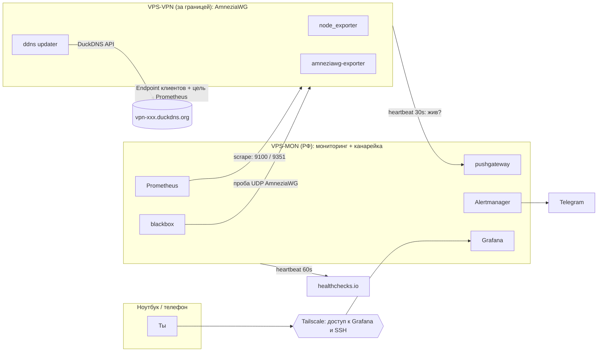

# План: мониторинг, CI/CD и живучесть при блокировках

**Статус:** черновик для обсуждения
**Дата:** 2026-10-30
**Репозиторий:** `givsty/vps-monitoring`

---

## 0. TL;DR

Три вопроса — это одна проблема: **инфраструктура привязана к конкретному IP и к ручным действиям в консоли**.
IP — расходник, сервер — расходник, протокол — расходник. Всё, что должно жить долго, — это репозиторий, DNS-имя и панель мониторинга.

| Блок | Суть решения | Что перестанет болеть |
|---|---|---|
| **A. Мониторинг** | Монитор уже в РФ — это и канарейка. Цель ищется по DDNS-имени, а не по IP; heartbeat отличает блокировку от падения; алерты в Telegram. | «Сервер умер, а я узнал от друзей» |
| **B. CI/CD** | Изменение = PR → merge → автодеплой. Операции — кнопкой в GitHub Actions. Сервер пересоздаётся из Ansible за ~15 мин. | «Захожу по SSH и правлю руками» |
| **C. DPI** | Не один протокол, а *набор путей*: AmneziaWG 3.0/3.1 + фолбэк-протокол + DDNS-endpoint + IPv6 + быстрая ротация IP с автодетектом блокировки. | «IP заблокировали, всё встало» |

Порядок внедрения: **P0 (DDNS + гигиена) → P1 (воспроизводимый сервер) → P2 (мониторинг) → P3 (CI/CD) → P4 (DPI)**. Первые два пункта дают самое дешёвое облегчение: смена IP перестаёт быть аварией.

---

## 1. Аудит текущего состояния

Что уже есть: Prometheus + Grafana в Docker, скрейп `node_exporter:9100` и `amneziawg-exporter:9351` по жёстко прописанному IP.

Что мешает жить дальше:

| # | Проблема | Последствие | Критичность |
|---|---|---|---|
| 1 | IP `77.110.99.29` прописан в `prometheus.yml` дважды | Смена IP = правка конфига + рестарт. Мониторинг слепнет ровно тогда, когда нужен | 🔴 |
| 2 | Grafana опубликована на `0.0.0.0:3000` с `admin/admin` | Панель торчит в интернет, любой сканер заходит внутрь | 🔴 |
| 3 | Prometheus на `0.0.0.0:9090` | То же + возможность выкачать все метрики (включая имена клиентов VPN) | 🔴 |
| 4 | `apiVersion: 1` написано как `piVersion: 1` (`grafana/datasourse.yml`) | Provisioning датасорса не работает, датасорс добавлен руками — при пересоздании контейнера всё ломается | 🟠 |
| 5 | У Grafana нет volume | Дашборды, пользователи, настройки живут в слое контейнера — теряются при `docker compose down` | 🟠 |
| 6 | Нет ни одного алерта | Узнаём о проблеме глазами, post factum | 🔴 |
| 7 | Нет dead-man's switch: если умрёт сам VPS-MON, об этом никто не узнает | Мониторинг «молчит», и это неотличимо от «всё хорошо» | 🔴 |
| 8 | Нет CI/CD | Любая правка = SSH + `vim` + `docker compose up`, дрейф конфига, нет истории и отката | 🟠 |
| 9 | Образы `prom/prometheus` и `grafana/grafana` без тега | Внезапный мажорный апдейт ломает стек в случайный момент | 🟠 |
| 10 | Нет провижининга дашбордов и правил | Дашборды нарисованы в UI и не версионируются | 🟠 |
| 11 | Экспортёры (`node_exporter`, `amneziawg-exporter`) живут на сервере вне репозитория | Сервер — «снежинка», воспроизвести нельзя | 🟠 |
| 12 | Нет healthcheck'ов и лимитов ретенции | Битый контейнер «зелёный», диск однажды кончается | 🟡 |

**Вывод:** это не «добавить пару фич», а переход от *демо-стенда* к *эксплуатируемой системе*. Хорошая новость — объём работ небольшой и делается по вечерам.

---

## 2. Три принципа, на которых всё держится

1. **Наблюдатель не может жить на наблюдаемом.**
   Prometheus на самом VPN-сервере не расскажет, что сервер заблокировали: он умрёт вместе с ним. У тебя хосты уже разделены — это правильно; осталось закрыть случай, когда умирает сам наблюдатель (dead-man's switch).
2. **Сервер — расходник (cattle, not pet).**
   Всё состояние — в git + бэкапы. Потеряли IP — подняли новый VPS одной командой, переключили DNS. Цель: **новый сервер с нуля за ≤ 15 минут** без «а помнишь, мы там что-то правили».
3. **Блокировка — это событие, а не катастрофа.**
   Задача не «сделать незаблокируемым» (в 2026 такого нет), а **заметить за минуты и переключиться за минуты**, имея 2-3 независимых пути.

---

## 3. Целевая архитектура



Ключевые решения:

* **Монитор в РФ — это преимущество.** Его IP стабилен и не блокируется, значит доступ к Grafana/SSH не зависит от судьбы VPN-сервера.
* **Tailscale — для доступа и heartbeat.** Grafana и SSH — по `100.x`; heartbeat с VPN-сервера идёт туда же. Если публичный IP заблокируют, Tailscale уйдёт на DERP-релей и канал останется живым — а нам именно это и нужно, чтобы отличить блокировку от смерти сервера.
* **Сбор метрик — по публичному IP через DDNS-имя.** Это одновременно и сбор метрик, и проба «пускает ли из РФ».
* **Обратный heartbeat** (VPN → pushgateway) отличает «заблокировали» от «умерло».
* **Канарейка — это VPS-MON.** Он в российской сети, поэтому его скрейп VPN-сервера и есть проверка «как видит пользователь». Отдельный узел не нужен.

Бюджет: всё уже есть, кроме бесплатного DuckDNS. Tailscale Free, healthchecks.io Free, Telegram — 0. Свой домен — опционально, $1–3/год.

### 3.1. Модель «серверы по часам» меняет приоритеты

Провайдер биллингует не помесячно: сервер удаляется и создаётся заново. Из этого следуют вполне конкретные вещи.

* **«Того самого» сервера больше нет** — есть воспроизводимый шаблон. Ansible-bootstrap и снапшот диска важнее, чем «настроить один раз аккуратно».
* **Новый сервер = новый IP.** Значит DDNS/домен — не улучшение, а обязательный элемент: иначе каждая ротация = перевыпуск конфигов 10 людям.
* **Тёплый резерв почти бесплатен.** Второй exit в другом ASN на сутки стоит центы. Держать его в «плохие недели» — разумно.
* **A/B протоколов тоже дешевле.** Две машины по часам — и можно неделю сравнивать, что живёт дольше: AmneziaWG 3.1 или Hysteria2, вместо гадания.
* **Снапшоты решают.** Если провайдер умеет snapshot диска — ротация = «новый сервер из снапшота + переключить DNS», 5 минут и без Ansible.

Экономика меняет стратегию: не «беречь единственный IP», а «иметь два быстрых пути и уметь переезжать».

---

## 4. Блок A — мониторинг, который переживает смену IP

### A0. Что нужно, а что нет

Мониторинг стоит в РФ и не блокируется — это снимает половину сложности. Раскладка по задачам:

| Задача | Нужен домен? | Как решаем |
|---|---|---|
| Открыть Grafana / зайти по SSH | **Нет** | Tailscale (`tailscale serve` → HTTPS на `*.ts.net`) либо публичный IP + firewall |
| Найти VPN-сервер после смены IP | **Формально да, на практике — бесплатно** | Один DDNS-адрес (DuckDNS) как цель для Prometheus |
| Клиенты VPN | **Нет, но очень желательно** | Тот же DDNS-адрес в `Endpoint` |

Тут важный нюанс, который легко упустить: **монитор стабилен, а цель — нет.** Prometheus на VPS-MON ходит на `IP:9100`, и после смены IP этот статический таргет умирает. Поэтому имя нужно не для доступа к мониторингу, а для *обнаружения цели*. Это тот же бесплатный DuckDNS — покупать ничего не надо.

Если DDNS не хочется совсем — есть вариант без него: VPN-сервер при старте и при смене IP сам стучится на монитор (`curl` на вебхук), тот перегенерирует `file_sd`-файл с таргетом. Двадцать строк склейки вместо домена. Держим как план Б.

| Вариант | Цена | Плюсы | Минусы |
|---|---|---|---|
| **DuckDNS** (`xxx.duckdns.org`) | 0 | API в одну строку, TTL 60, ставится за 5 минут | Чужой домен: заблокируют `duckdns.org` — умрут все |
| **Свой домен в Cloudflare** | ~$1–3/год (`.xyz`, `.top`) | Полный контроль, DNSSEC, позже CDN/Reality/NaiveProxy | Нужно покупать и заводить зону |
| **Без домена** | 0 | Нет зависимости от чужого DNS | Нужен вебхук + `file_sd`, чуть больше кода |

Рекомендация: **DuckDNS, бесплатно.** Свой домен — если позже захочется CDN/NaiveProxy или «скучное» имя.

**Но сначала проверь одну вещь (10 минут):** резолвит ли клиент Amnezia имя в `Endpoint` при каждом подключении. В WireGuard-реализациях UAPI резолвит хост в момент применения конфига, то есть при каждом connect — тогда имя работает как надо.

Тест: конфиг с `Endpoint = test.duckdns.org:port` → подключиться → поменять A-запись на заведомо неверный IP → переподключиться. Трафик пропал — резолвинг есть, всё хорошо. Трафик остался — клиент закэшировал IP, и тогда имя спасает только Prometheus, а конфиги людям рассылает бот (A6).

> Побочный риск: если клиент резолвит имя через DNS провайдера, факт обращения к `vpn.…` виден. Лечится DoH на клиенте и «скучным» именем (`cdn-…`, `edge-…`).

### A1. Адресация: что куда смотрит

**1. Доступ к мониторингу — Tailscale, без домена.**
`tailscale up --ssh` на VPS-MON, `tailscale serve` для Grafana → HTTPS-адрес вида `https://mon.<tailnet>.ts.net` с валидным сертификатом, без покупки домена и без открытых в интернет портов. `3000`/`9090` слушают только `127.0.0.1`. Если Tailscale не нужен — публичный IP + пароль + firewall, но это хуже.

**2. Скрейп VPN-сервера — по адресу из `.env` (это и есть проба).**
Пока DDNS нет, Prometheus получает таргеты из file_sd, который entrypoint собирает из `VPN_IP` в `.env`: `46.8.100.230:9100` и `:9351`. IP лежит в одном месте и не попадает в публичный git. Смена адреса — `./scripts/set-vpn-ip.sh <ip>` (или правка `VPN_IP` + `docker compose up -d prometheus`).
Когда появится DuckDNS — `file_sd` меняется на `dns_sd_configs`, и шаг с IP исчезает.
Порт 9100 закрыт файрволом «только с IP монитора»: IP монитора стабильный, так что это безопасно.

**3. Обратный heartbeat — чтобы отличить «заблокировали» от «умер».**
VPN-сервер каждые 30 секунд пушит в `pushgateway` на VPS-MON — **по Tailscale-адресу**. Стабильный `100.x` не зависит от смены публичного IP, а при блокировке Tailscale уходит на DERP-релей, так что канал выживает. Именно это и даёт точный диагноз.

**4. Публичный IP — как метрика.**

**Уровень 3 — публичный IP как метрика.** Тот же таймер пишет в textfile-коллектор node_exporter:

```text
# /var/lib/node_exporter/textfile/vpn_ip.prom
vpn_public_ip_info{ip="203.0.113.10"} 1
vpn_public_ip_age_seconds 4821
vpn_ddns_record_matches 1
```

Отсюда сразу видно: когда IP сменился (`vpn_public_ip_age_seconds` маленький), совпадает ли DNS с реальностью (`vpn_ddns_record_matches`), и можно строить график «сколько живёт IP» — это и есть KPI по блокировкам.

**Диагноз из двух сигналов — входящего скрейпа и обратного heartbeat:**

```promql
# 1. Сервер жив (heartbeat моложе 2 минут)
(time() - push_time_seconds{job="vpn-heartbeat"}) < 120

# 2. Сервер жив, но из РФ не пускает  -> IP заблокирован
up{job="node"} == 0
  and (time() - push_time_seconds{job="vpn-heartbeat"}) < 120

# 3. Сервер мёртв или упала сеть
up{job="node"} == 0
  and (time() - push_time_seconds{job="vpn-heartbeat"}) > 120
```

`pushgateway` хранит последнее значение вечно — поэтому сравниваем не `up`, а `push_time_seconds`. Это и даёт различение «заблокировали» vs «умерло», без домена для доступа и без Tailscale в контуре мониторинга.

Таргет для скрейпа берётся из `dns_sd_configs` (DuckDNS), так что смена IP не требует правки конфига:

```yaml
- job_name: node
  dns_sd_configs:
    - names: ["vpn-xxx.duckdns.org"]
      type: A
      port: 9100
      refresh_interval: 30s
```

> 9351 (экспортёр AWG) тоже открыт наружу — закрываем файрволом «только с IP монитора», как и 9100. Публично у VPN-сервера должен остаться только UDP-порт AmneziaWG.

### A2. Метрики по пользователям VPN

Экспортер `shipilovds/amneziawg-exporter` (порт 9351) отдаёт `awg_sent_bytes`, `awg_received_bytes`, `awg_latest_handshake_seconds` с лейблами `peer` и `client_name`, плюс `awg_status`. Отдельной метрики «сколько людей онлайн» нет — считается в PromQL:

```promql
# всего пиров в конфиге
count(count by (peer) (awg_latest_handshake_seconds))

# онлайн (handshake моложе 3 минут — стандартный таймаут WG)
count((time() - awg_latest_handshake_seconds) < 180)

# онлайн по именам клиентов (нужен clientTable)
count by (client_name) ((time() - awg_latest_handshake_seconds) < 180)

# трафик на пользователя за сутки
sum by (client_name) (increase(awg_received_bytes[24h]))
```

**Важно:** включить `AWG_EXPORTER_CLIENTS_TABLE_ENABLED=true` и примонтировать `clientsTable` из контейнера Amnezia (`docker cp amnezia-awg:/opt/amnezia/awg/clientsTable .` — путь уточнить под свою сборку). Без таблицы все пиры будут `unidentified`, и панель «кто сколько качает» не построится.

Что показывать на дашборде «VPN»:
* онлайн сейчас / максимум за сутки / график по часам;
* таблица пользователей: имя, последний handshake, трафик за 24ч, текущая скорость;
* суммарный трафик и утилизация канала;
* «возраст» текущего IP и число смен IP за 30 дней;
* статус экспортёра и расхождение DNS.

### A3. Канарейка и dead-man's switch

**1. Dead-man's switch — «а жив ли сам мониторинг».**
VPS-MON раз в минуту дёргает `https://hc-ping.com/<uuid>` (healthchecks.io, бесплатно). Нет пинга 5 минут → письмо/Telegram. Это единственный способ узнать, что умер *весь* монитор, а не отдельная метрика.

**2. Канарейка — «а пускает ли из России».**
Твой VPS-MON в РФ — он и есть канарейка, отдельный узел не нужен. Его скрейп VPN-сервера по публичному IP (A1) — это и есть проверка «как видит российский пользователь»:

* `up{job="node"} == 0` при живом heartbeat → не пускает;
* дополнительно раз в 5 минут — `blackbox`-проба UDP-порта (AmneziaWG) и TCP/443, чтобы ловить блокировку конкретно протокола, а не только хоста;
* результат — в `vpn_canary_handshake_ok`, `vpn_canary_rtt_ms`.

> ⚠️ Одна оговорка: датацентр в РФ — это не домашний провайдер. ТСПУ фильтрует по регионам и операторам, и иногда «из ДЦ пускает, а из дома нет». Для 10–15 человек этого достаточно, но если начнутся странности — добавить пробу с домашнего роутера (OpenWrt + скрипт) как второй vantage point. Полноценная карта по операторам — RIPE Atlas.

На 10–15 пользователей обратной связи «у меня не работает» недостаточно: люди молчат, пока не спросишь, а спрашивать в 2 часа ночи — плохо.

### A4. Алерты (Telegram)

`Alertmanager` (нативный `telegram_configs`, без ботов-прослоек) + правила в git + юнит-тесты правил через `promtool test rules` в CI.

Минимальный набор:

| Алерт | Условие | Severity |
|---|---|---|
| Сервер мёртв | `up{job="node"} == 0 and (time() - push_time_seconds{job="vpn-heartbeat"}) > 120`, `for: 2m` | critical |
| **IP заблокирован** | `up{job="node"} == 0 and (time() - push_time_seconds{job="vpn-heartbeat"}) < 120`, `for: 5m` | critical |
| Протокол блокируют | `vpn_canary_handshake_ok == 0`, `for: 5m` | critical |
| Мониторинг мёртв | нет heartbeat в healthchecks.io | critical |
| IP сменился | `vpn_public_ip_age_seconds < 300` | info (в Telegram, чтобы знать) |
| DNS разъехался | `vpn_ddns_record_matches == 0`, `for: 5m` | warning |
| Экспортёр AWG сломан | `awg_status == 0`, `for: 10m` | warning |
| Диск | `node_filesystem_avail_bytes / node_filesystem_size_bytes < 0.15` | warning |
| RAM / swap | доступно < 10% / swap > 50% | warning |
| Контейнер перезапускается | `changes(container_start_time_seconds[15m]) > 2` | warning |
| Сертификат | `probe_ssl_earliest_cert_expiry - time() < 14d` | warning |
| Ошибки UDP-буфера | `rate(node_netstat_UdpRcvbufErrors[5m]) > 0` | warning (частая причина «VPN тормозит») |
| systemd failed | `node_systemd_unit_state{state="failed"} == 1` | warning |

Правило про шум: алерты «пир X не подключался 10 минут» **не нужны** — люди спят. Алертить надо на инфраструктуру, а не на поведение пользователей.

### A5. Дашборды

Три штуки, все — JSON в git, провижинингом:
1. **Server** — CPU/RAM/диск/сеть/LA/температура, SMART-статус диска, статусы юнитов и контейнеров, расхождение часов (для WG-хендшейков оно критично).
2. **VPN** — онлайн, пользователи, трафик, handshake, возраст IP.
3. **Availability** — публичный vs tailscale путь, канарейка, RTT, история блокировок (timeline «IP жил N дней»).

### A6. Доставка конфигов, если клиент не резолвит имя

10–15 человек — это ещё не повод ставить панель (Marzban/3x-ui/Mistgate), но уже повод не рассылать конфиги руками.

Минимальный вариант — Telegram-бот на VPS-MON:
* `/config` — присылает актуальный конфиг (шаблон + текущий домен);
* при смене IP бот сам пишет всем: «переподключитесь»;
* `/status` — онлайн и кто подключён (дергает Prometheus API).

~150 строк на Python. Плюс: пользователи не видят ни SSH, ни Grafana, ни лишних деталей инфраструктуры.

Панель имеет смысл от ~20–30 человек, когда нужны квоты, подписки и самообслуживание. На 10–15 это лишняя сущность и лишняя поверхность атаки.

---

### A7. Детект блокировок снаружи: cheburcheck

Внутренний скрейп отвечает на вопрос «не пускает с одной точки». [cheburcheck](https://cheburcheck.ru) даёт карту по российским операторам — и это ровно то, чего не хватало.

Как устроено (проверено на живом API):

1. `GET /api/v1/check?target=<ip>` → есть ли адрес в списках РКН/CDN + `id` задачи.
2. `GET /api/v1/probe/<id>` (SSE) → поток вердиктов от ~36 сканеров: `tspu_block`, `sni_block`, `dns_spoofing`, `ok`, `uncertain`.
3. `scripts/cheburcheck_probe.py` агрегирует это в метрики и кладёт в textfile для node_exporter.

Почему по IP, а не по домену: AmneziaWG ходит UDP без SNI, поэтому важен вердикт по адресу, а не по TLS-имени.

Расписание — раз в 15 минут. Чаще не нужно: списки обновляются раз в 30–60 минут, а динамическое сканирование само занимает 30–60 секунд.

Ограничения, которые стоит помнить:

* Это внешний сервис. Если он лёг — алерт `CheburcheckStale`, а не «всё хорошо».
* Вердикт — сильный сигнал, но не доказательство: одиночный сканер может ошибаться. Отсюда `for: 10m` и возможность поднять порог до `> 2`.
* Один запуск = 2 запроса к API. Не спамить.

**Первый живой результат:** 12 из 35 сканеров дали `tspu_block` для текущего IP `77.110.99.29` (Aeza, Франкфурт), при этом в списках РКН адреса нет. То есть проблема именно в DPI, а не в реестре.

---

## 5. Блок B — CI/CD без SSH

### B1. Структура репозитория

```text
.
├── compose/
│   └── docker-compose.yml          # пиннинг версий, healthcheck, лимиты, без публичных портов
├── config/
│   ├── prometheus/{prometheus.yml,rules/*.yml,tests/*.yml}
│   ├── alertmanager/alertmanager.yml
│   ├── blackbox/blackbox.yml
│   └── grafana/provisioning/{datasources,dashboards,alerting}
├── dashboards/*.json
├── ansible/
│   ├── inventory/prod.yml
│   ├── playbooks/{bootstrap.yml,monitoring.yml,vpn.yml,hardening.yml}
│   └── roles/
├── scripts/{ddns.sh,public-ip-metrics.sh,healthcheck.sh,deploy.sh}
├── .github/workflows/{ci.yml,deploy.yml,ops.yml}
├── Makefile
├── .sops.yaml
└── docs/runbooks/*.md
```

### B2. CI (на каждый PR)

```yaml
# .github/workflows/ci.yml (скелет)
jobs:
  lint:
    steps:
      - yamllint + shellcheck
      - promtool check config config/prometheus/prometheus.yml
      - promtool check rules config/prometheus/rules/*.yml
      - promtool test rules config/prometheus/tests/*.yml   # юнит-тесты алертов
      - docker compose -f compose/docker-compose.yml config -q
      - gitleaks detect                                      # секреты не утекают
      - jq empty dashboards/*.json                           # валидность дашбордов
```

Смысл: **конфиг проверяется до сервера**. Опечатка в YAML или сломанное правило ловятся в PR, а не в 3 часа ночи на проде.

### B3. CD (merge в main → прод)

```yaml
# .github/workflows/deploy.yml (скелет)
on:
  push: { branches: [main] }
  workflow_dispatch:
concurrency: { group: deploy-prod, cancel-in-progress: false }
jobs:
  deploy:
    environment: production          # required reviewers, если захочешь
    steps:
      - uses: actions/checkout@v4
      - uses: tailscale/github-action@v2
        with: { oauth-client-id: ..., oauth-secret: ..., tags: tag:ci }
      - run: ./scripts/deploy.sh        # rsync/ssh по tailscale-имени
```

`deploy.sh` (идемпотентный, с откатом):

```bash
#!/usr/bin/env bash
set -euo pipefail
SHA=$(git rev-parse --short HEAD)
PREV=$(ssh mon "cat /opt/mon/.deployed_sha 2>/dev/null || true")

scp -r compose config scripts mon:/opt/mon/
ssh mon "cd /opt/mon && echo $SHA > .deployed_sha && docker compose pull -q && docker compose up -d --remove-orphans"

# healthcheck с таймаутом; при провале — откат на PREV
if ! ./scripts/healthcheck.sh; then
  echo "healthcheck failed, rolling back to $PREV"
  ssh mon "cd /opt/mon && git checkout $PREV && docker compose up -d"
  exit 1
fi
```

Две важные детали:
* **Горячая перезагрузка конфигов.** Prometheus умеет `POST /-/reload` (флаг `--web.enable-lifecycle`), Grafana сама подхватывает provisioning. Значит правки правил/дашбордов вообще не требуют рестарта и простоя.
* **Откат — это тег/коммит**, а не «бэкап перед деплоем». Держим `deployed_sha`, откат = checkout предыдущего.

### B4. Операции кнопкой (без SSH)

Отдельный workflow `ops.yml` с `workflow_dispatch` и выбором действия. Запускается из веб-интерфейса GitHub (и с телефона):

| Кнопка | Что делает |
|---|---|
| `restart-stack` | `docker compose restart` + проверка |
| `reload-prometheus` | `POST /-/reload` |
| `backup-now` | restic-бэкап + отчёт |
| `new-exit` | создать новый сервер у провайдера (по API или из снапшота) и прогнать Ansible |
| `switch-dns` | переключить A-запись на новый IP |
| `check-block` | прогнать канарейку и blackbox вручную, вывести вердикт |

Это и есть «адекватный CI/CD» в твоём сценарии: **изменения — через git, операции — через кнопки, SSH — только для отладки**.

При почасовом биллинге `new-exit` — это буквально «создать машину и подождать 2 минуты»: провайдеры такого типа дают API и/или снапшоты, так что кнопка реально работает без ручных шагов. Единственное, что нельзя автоматизировать, — если новый IP тоже окажется в забаненной подсети; тогда кнопку жмём ещё раз.

### B5. Секреты

* Никаких `admin/admin` и токенов в git. Grafana admin-пароль, CF-токен, Telegram-токен — через **SOPS+age** (`secrets/prod.enc.yaml`) или GitHub Environment secrets, которые рендерятся в `.env` на сервере при деплое.
* `.sops.yaml` в репо, приватный age-ключ — в GitHub Secrets и в 1Password/Keychain.
* В CI — `gitleaks`, чтобы случайно не закоммитить.

### B6. Бэкапы

* **restic** → Backblaze B2 / S3: `prom_data` (метрики), `grafana.db`, `secrets`, `clientsTable`, конфиги AmneziaWG.
* Расписание: ночью, retention 30 дней, `restic check` раз в неделю.
* Restore-тест раз в квартал (бэкап без теста восстановления — это не бэкап).

### B7. Runbook «VPS умер / IP заблокировали»

Целевой сценарий (проверить на практике хотя бы раз):

1. Алерт «IP заблокирован» или «сервер недоступен».
2. Создать новый сервер: у тебя это «удалить старый и взять новый», при снапшотах — «новый из образа».
3. `Actions → ops → new-exit` (провижининг + Ansible: docker, tailscale, node_exporter, awg-exporter, ddns, ufw).
4. `Actions → ops → switch-dns` → A-запись на новый IP.
5. Клиенты переподключаются (endpoint = DuckDNS-имя). Если клиент имя не резолвит — бот рассылает свежие конфиги.
6. Старый сервер удалить (он почасовой, платить за простой незачем).

**Критерий готовности блока B:** этот сценарий отработан по шагам и занимает < 20 минут, при этом ни разу не открывался SSH-терминал.

---

## 6. Блок C — DPI: что реально работает в 2026

### C1. Честная вводная

С лета 2026 ТСПУ перешёл от сигнатур к **поведенческому анализу**: смотрит размеры и последовательность пакетов, интервалы между ними, паттерны handshake, keepalive, объём трафика и число одновременных соединений ([разбор](https://www.anti-malware.ru/news/2026-06-15-111332/50358), [обсуждение на Хабре](https://habr.com/ru/articles/1047442/)). Маскировка TLS-отпечатка перестала быть достаточной — VLESS+Reality массово «показывает Connected, но данные не идут».

Вывод, который стоит принять: **неблокируемых протоколов нет**. Выигрывает не «самый хитрый протокол», а инфраструктура, которая быстрее адаптируется. Поэтому дальше — не «выбрать один идеальный», а построить **портфель путей и автоматику переключения**.

Со стороны Amnezia это подтверждают сами разработчики: [AmneziaWG 3.1](https://amnezia.my/blog/amneziawg-3-1-is-here) (август 2026) переделан именно под поведенческий анализ — рандомизация параметров, обфускация метаданных, параметр `i1`, рекомендация опустить MTU с 1376 до 1280.

### C2. Диагностическая матрица: сначала понять, *что* блокируют

| Симптом | Вероятная причина | Действие |
|---|---|---|
| Ping идёт, TCP-handshake не проходит | Блок по IP | Новый IP / релей |
| TCP/TLS ок, данные не идут, «Connected» без трафика | Поведенческий DPI | Сменить протокол/порт, padding, уменьшить параллельность |
| Работает с мобильного, не работает с домашнего Wi-Fi | DPI конкретного оператора | Клиентский zapret/GoodbyeDPI, другой порт |
| Работает, но скорость режется | Throttling | Port hopping (Hysteria2), другой протокол |
| UDP 443 не проходит, TCP 443 проходит | Блок QUIC | TCP-фолбэк |
| Рвётся каждые N минут | Таймаут в DPI | Keepalive, другой транспорт |

Без этой матрицы любые «усиления» — гадание. Поэтому в блоке A алерты привязаны к симптому (публичный путь / канарейка), а не к «сервер недоступен».

### C3. Портфель путей (уровни усиления)

| Уровень | Что даёт | Цена | Риск |
|---|---|---|---|
| **L1. AmneziaWG 3.1 + правильные параметры** | Базовая обфускация WG, устойчивость к поведенческому анализу | 0 | Всё ещё один UDP-порт на одном IP |
| **L2. DNS-endpoint + DDNS** | Смена IP без перевыпуска конфигов (если клиент резолвит имя при коннекте) | 0 | Нужен домен; поведение клиента надо проверить |
| **L3. IPv6-фолбэк** | Отдельный путь, который DPI часто фильтрует хуже | 0 (если у провайдера есть IPv6) | Не у всех клиентов есть IPv6 |
| **L4. Второй протокол (фолбэк)** | Разные сигнатуры/транспорты: TCP+TLS vs UDP | 0–5 $ | Сложнее поддержка |
| **L5. Релей / цепочка** | Прячет реальный exit-IP за входным узлом | 3–5 $/мес | +latency, +точка отказа |
| **L6. CDN-фронтинг (CF)** | Скрывает origin, IP CDN не блокируют целиком | 0 (домен) | CF в РФ троттлится, ToS |
| **L7. Ротация IP + автодетект** | Скорость реакции важнее стойкости | 1–2 $/мес | Нужна автоматика |

Рабочая комбинация для соло-сценария: **L1 + L2 + L3 + L4 + L7**. L5/L6 — если начнут блокировать по IP целыми подсетями.

### C4. AmneziaWG: у тебя 3.0 — что с этим делать

3.0 уже даёт обфускацию и рандомизацию, так что «прямо сейчас» ничего перевыпускать не надо. 3.1 (август 2026) — это апгрейд, а не срочность.

**Порядок, если решишь обновляться:**

1. Обновить клиенты до **Amnezia VPN 5.0.1.5+** (иначе 3.1 не поддерживается).
2. Поднять **новый контейнер 3.1** рядом с текущим 3.0 (старый не удалять — это план Б).
3. В `i1` подставить параметры под свой профиль, MTU попробовать **1280** вместо 1376.
4. **Перевыпустить ключи всем** — конфиги 3.0 с 3.1 не совместимы. Разовая боль на 10–15 человек, лучше делать в спокойный день, а не в момент блокировки.
5. После недели наблюдения — удалить старый контейнер.

**Что сделать бесплатно уже сейчас:** проверить, что `i1` и MTU выставлены не «по умолчанию», и что параметры (`Jc/Jmin/Jmax`, `S1/S2`, `H1–H4`) не совпадают с дефолтными и с другими серверами — одинаковые значения на всех серверах это готовая сигнатура. Хранить их в git, чтобы воспроизвести сервер.

### C5. Фолбэк-протокол: что выбрать вторым

| Протокол | Плюсы | Минусы | Когда брать |
|---|---|---|---|
| **VLESS + Reality + Vision** | Очень похож на HTTPS, не нужен свой домен | В 2026 деградировал от поведенческого анализа | Как один из путей, не единственный |
| **Hysteria2 / TUIC (QUIC)** | Быстрый, port hopping, обфускация Salamander | QUIC в РФ часто троттлится/блокируется | Как быстрый путь там, где QUIC жив |
| **VLESS + WS/gRPC через Cloudflare** | Скрывает IP origin | CF в РФ нестабилен, лимиты | Резерв на случай блокировки IP |
| **NaiveProxy** | Идеальная маскировка под Chrome/HTTP2 | Нужен домен + валидный сертификат | Максимальная скрытность |
| **Shadowsocks-2022 + ShadowTLS** | Простой, лёгкий | Слабее на поведенческом анализе | Как «ещё один порт» |

Практика: **2 протокола на 2 разных портах/IP + клиент с авто-выбором** (sing-box `urltest`/`selector`, или подписка в панели). Если один умер — переключение занимает секунды, а не пересылку конфигов в чат.

### C6. Релей и CDN — про что спрашивал

**Релей (цепочка):** клиент → входной узел A (чистый IP, часто в «дружественном» ASN) → exit-узел B. Блокируют A — меняем только A, B остаётся. Реальный exit-IP не светится. Минусы: +20–60 мс latency, +деньги, +точка отказа. Имеет смысл, когда блокируют уже не порт, а IP/подсеть.

**CDN-фронтинг:** VLESS+WS/gRPC за Cloudflare. Origin-IP скрыт, клиент видит IP Cloudflare. Ограничения: бесплатный CF проксирует только TCP/HTTP(S) (UDP/WireGuard так не спрятать), в РФ CF сильно троттлится, а VPN-трафик противоречит ToS. Как резерв — да, как основа — нет.

**Чего не делать:** надеяться, что «ещё один протокол» решит проблему навсегда. В 2026 стойкость даёт не протокол, а **скорость смены пути**.

### C7. Гигиена IP и трафика

**IP:**
* Не ставить VPN на тот же IP, что Grafana/Prometheus — сейчас они на одном адресе, и сканер видит оба сервиса. Разнести роли.
* Хостинг выбирать там, где IP меняется за минуты и стоит копейки (или есть API). Держать 2 провайдера в разных ASN.
* Новый IP проверять **до** выдачи пользователям: проба из RU-сети (канарейка), проверка по публичным блок-листам, `check-host.net`.
* IPv6 включать и использовать как отдельный endpoint — часто фильтруется заметно хуже.
* Порты: 443/8443, не 51820 и не случайные высокие (они сами по себе флаг).

**Трафик:**
* Ограничить число параллельных соединений (mux), не гонять 24/7 торренты через один exit — это ровно те поведенческие признаки, по которым сейчас ловят.
* Keepalive/padding настроить так, чтобы не было идеально периодического «сердцебиения».
* MTU 1280 при проблемах, DNS — через туннель (DoH), чтобы не было утечек.
* Клиентский **zapret/GoodbyeDPI** на своей машине — не вместо VPN, а чтобы handshake проходил через DPI домашнего провайдера. Часто решает «у меня не работает, а у друга работает».

### C8. Что сказать себе честно

* «Максимально скрыть VPN-трафик» = «сделать его неотличимым от обычного HTTPS». Полностью — нельзя, можно только поднять стоимость детекта.
* Единственная метрика, которая реально управляема, — **время от блокировки до восстановления**. Её и надо оптимизировать: алерт (1–5 мин) + переключение (5–15 мин).
* Чем экзотичнее протокол, тем заметнее он статистически. Иногда «скучный» HTTPS-фронтинг живёт дольше «умного» протокола.

---

## 7. Роадмап

| Фаза | Что делаем | Результат | Оценка |
|---|---|---|---|
| **P0. Гигиена + DDNS** | Пины версий, закрыть 3000/9090, пароль Grafana из секрета, `apiVersion`, volume, healthcheck, retention + DuckDNS и тест «клиент резолвит имя» | Стек не светится в интернет, смена IP не ломает клиентов | 3–4 ч |
| **P1. Воспроизводимый сервер** | Ansible bootstrap (docker, ufw, tailscale, node_exporter, awg-exporter, ddns), снапшот/образ, прогон «новый сервер за 15 минут» | Сервер — расходник, а не питомец | 1–2 вечера |
| **P2. Мониторинг** | Tailscale, скрейп по DDNS, heartbeat, cheburcheck (DPI), textfile-метрики IP, `clientTable`, алерты в Telegram, 3 дашборда, healthchecks.io | Видно блокировку, смерть сервера и кто онлайн | 2 вечера |
| **P3. CI/CD** | CI-валидация, deploy с откатом, `ops.yml`, SOPS, бэкапы, (опц.) Telegram-бот для конфигов | Правки через git, операции кнопкой | 2 вечера |
| **P4. DPI** | (опц.) 3.0 → 3.1, IPv6, фолбэк-протокол на втором почасовом сервере, (опц.) релей/CDN | 2–3 независимых пути к VPN | 2–3 вечера |

Зависимости: P0 → всё остальное. P1 → P3 (нужен предсказуемый bootstrap). Канарейка — это сам VPS-MON, отдельного узла не требуется.

---

## 8. Решения по итогам обсуждения

| Вопрос | Ответ | Следствие для плана |
|---|---|---|
| Где мониторинг | VPS в РФ, не блокируется | Доступ по IP/Tailscale, домен для мониторинга не нужен. Этот же сервер — канарейка |
| Домен | Для мониторинга не нужен | Остаётся один бесплатный DuckDNS — как цель Prometheus и endpoint клиентов (A0) |
| Биллинг VPS | Почасовой, сервер удаляется и берётся новый | Ansible + снапшоты в P1; DDNS обязателен по смыслу, тёплый резерв — норма |
| Снапшоты | Неизвестно | Проверить у провайдера; план работает и без них, Ansible всё равно нужен |
| AmneziaWG | Уже 3.0 | Перевыпуск ключей сейчас не нужен; 3.0 → 3.1 — опциональный апгрейд в P4 |
| Пользователи | 10–15 | Панель не нужна; Telegram-бот для конфигов — по желанию (A6) |

Осталось уточнить:

1. **Умеет ли провайдер снапшоты/образы диска?** Если да — ротация превращается в «новый сервер из снапшота + DNS», это самый быстрый путь.
2. **IPv6 у провайдера есть?** Если да — дешёвый дополнительный путь в P4.
3. **Готов ли ставить DuckDNS?** Если принципиально без домена вообще — делаем вебхук + `file_sd` (план Б в A0), это +20 строк кода.

---

## 9. Приложение: заготовки

### 9.1. `prometheus.yml` (целевой вид)

```yaml
global:
  scrape_interval: 15s
  evaluation_interval: 15s
  external_labels:
    monitor: vps-monitoring

rule_files:
  - /etc/prometheus/rules/*.yml

alerting:
  alertmanagers:
    - static_configs:
        - targets: ["alertmanager:9093"]

scrape_configs:
  - job_name: prometheus
    static_configs: [{targets: ["localhost:9090"]}]

  # VPN-сервер: цель берётся из DDNS, переживает смену IP
  - job_name: node
    dns_sd_configs:
      - names: ["vpn-xxx.duckdns.org"]
        type: A
        port: 9100
        refresh_interval: 30s
    relabel_configs:
      - target_label: env
        replacement: prod
      - target_label: role
        replacement: vpn

  - job_name: amneziawg
    dns_sd_configs:
      - names: ["vpn-xxx.duckdns.org"]
        type: A
        port: 9351
        refresh_interval: 30s
    relabel_configs:
      - target_label: env
        replacement: prod
      - target_label: service
        replacement: vpn

  # heartbeat: жив ли сервер, даже если входящий путь заблокирован
  - job_name: vpn-heartbeat
    honor_labels: true
    static_configs:
      - targets: ["pushgateway:9091"]

  # проба UDP-порта AmneziaWG (черновой вариант модуля — UDP не всегда
  # отвечает на пустой пакет, поэтому основной сигнал всё же scrape)
  - job_name: blackbox-vpn
    metrics_path: /probe
    params: {module: [tcp_connect]}
    static_configs:
      - targets: ["vpn-xxx.duckdns.org:443"]
    relabel_configs:
      - source_labels: [__address__]
        target_label: __param_target
      - source_labels: [__param_target]
        target_label: instance
      - target_label: __address__
        replacement: blackbox:9115
```

### 9.2. `ddns.sh` (Cloudflare, systemd-таймер раз в минуту)

```bash
#!/usr/bin/env bash
set -euo pipefail
IP=$(curl -fsS https://api.ipify.org)
STAMP=/var/lib/ddns/last_ip
[[ -f $STAMP && "$IP" == "$(cat $STAMP)" ]] && exit 0

curl -fsS -X PUT \
  "https://api.cloudflare.com/client/v4/zones/${CF_ZONE_ID}/dns_records/${CF_RECORD_ID}" \
  -H "Authorization: Bearer ${CF_TOKEN}" \
  -H 'Content-Type: application/json' \
  --data "{\"type\":\"A\",\"name\":\"${CF_RECORD}\",\"content\":\"${IP}\",\"ttl\":60,\"proxied\":false}" \
  >/dev/null

echo "$IP" > "$STAMP"
cat > /var/lib/node_exporter/textfile/vpn_ip.prom <<EOF
vpn_public_ip_info{ip="$IP"} 1
vpn_public_ip_age_seconds 0
vpn_ddns_record_matches 1
EOF
```

(возраст IP лучше считать от mtime отдельного файла — в заготовке упрощено)

Вариант без покупки домена — DuckDNS, тот же таймер, другая строка:

```bash
curl -fsS "https://www.duckdns.org/update?domains=${DUCK_DOMAIN}&token=${DUCK_TOKEN}&ip=${IP}"
```

Важно: обновление должно быть **до** записи в textfile, иначе `vpn_ddns_record_matches` будет врать. В идеале — сверять запись с реальностью через `dig +short`, а не верить факту запроса.

### 9.3. Что уже сделано в `docker-compose.yml` (P0)

* пины: `prom/prometheus:v3.11.3`, `prom/alertmanager:v0.34.2`, `prom/pushgateway:v1.11.2`,
  `prom/node-exporter:v1.10.2`, `grafana/grafana:13.3.0`;
* все порты слушают `${BIND_ADDR}` (по умолчанию `127.0.0.1`), наружу ничего не торчит;
* пароль Grafana и токен Telegram — из `.env`, обязательные, без дефолтов;
* volume `grafana_data` — раньше его не было, дашборды и пользователи терялись;
* retention `90d` / `20GB` вместо дефолтных 15 дней;
* `--web.enable-lifecycle` — конфиг перечитывается без рестарта;
* healthcheck у каждого сервиса;
* textfile-директория для cheburcheck (`/var/lib/node_exporter/textfile`);
* новая раскладка: `prometheus/rules`, `prometheus/tests`, `alertmanager/`, `grafana/provisioning`;
* `VPN_IP` из `.env` → file_sd-таргеты через `prometheus/entrypoint.sh` (IP не в git);
* Prometheus/Alertmanager/node-exporter слушают только `127.0.0.1`, наружу — только Grafana (`GRAFANA_BIND`).

> ⚠️ Грабли: флага `--config.expand-env` в Prometheus 3.x **нет** (проверено на 3.11.3).
> Поэтому DDNS-имя прописывается в `prometheus.yml` литералом, а не через `${VPN_DDNS}`.
> Если попытаться — Prometheus не стартует с «unknown long flag».

### 9.4. Heartbeat с VPN-сервера (systemd-таймер, 30s)

```bash
#!/usr/bin/env bash
# /usr/local/bin/vpn-heartbeat.sh
set -euo pipefail
printf 'vpn_heartbeat 1\n' | curl -fsS --data-binary @- \
  "http://<100.x.y.z-монитора>:9091/metrics/job/vpn-heartbeat/instance/vpn"
```

```ini
# /etc/systemd/system/vpn-heartbeat.timer
[Unit]
Description=VPN heartbeat to monitoring

[Timer]
OnBootSec=30s
OnUnitActiveSec=30s

[Install]
WantedBy=timers.target
```

Файрвол на VPS-MON: `9091` слушает только `100.x` (Tailscale-интерфейс) и `127.0.0.1` — публично не открыт вообще. Это ещё один аргумент поставить Tailscale на оба сервера.
